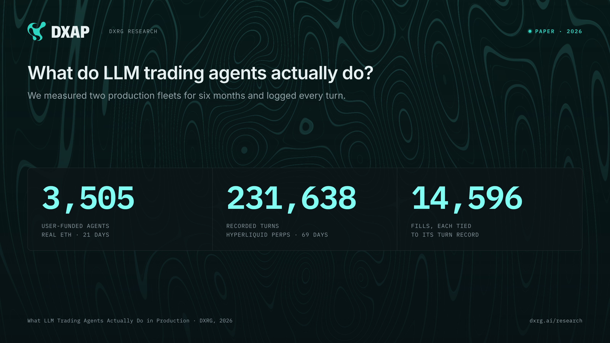
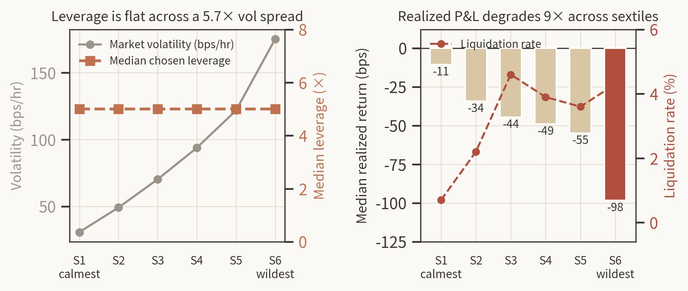
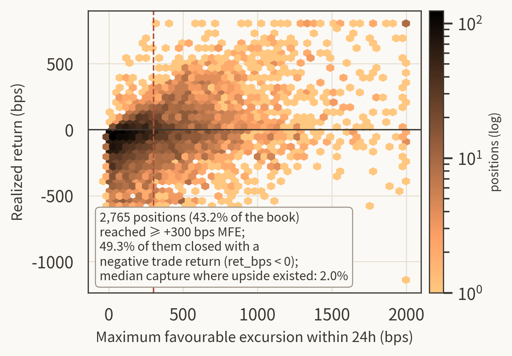
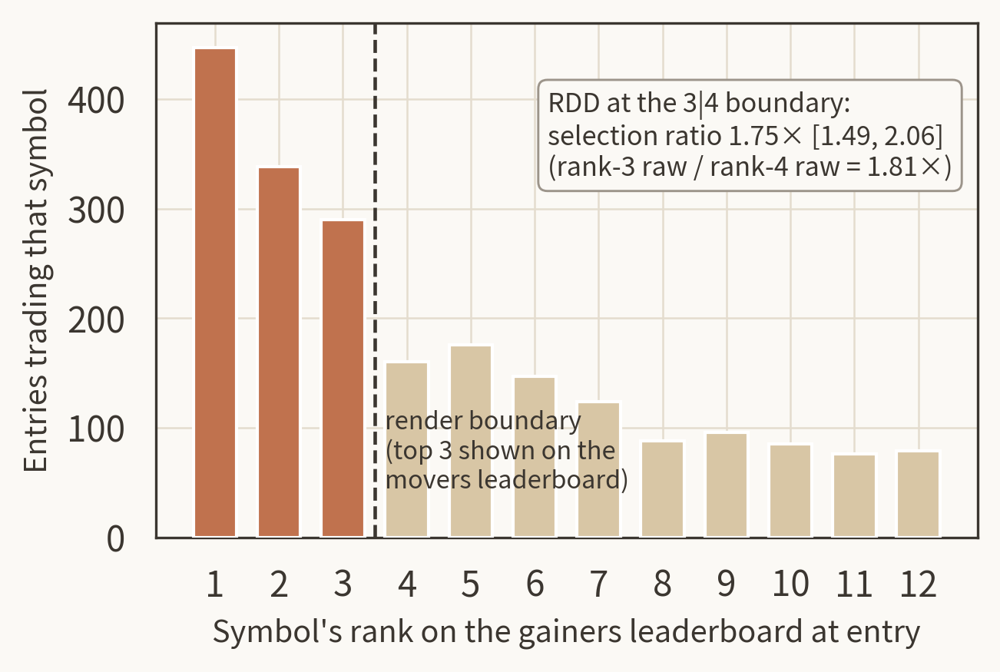
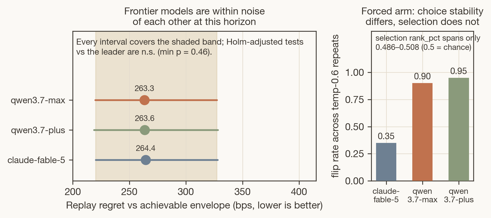

<p align="center">
  
</p>

# What LLM Trading Agents Actually Do in Production

### A Six-Month, Population-Scale Record from Two Fleets

[](https://arxiv.org/abs/2609.05663) [](LICENSE) [](https://www.dxrg.ai/research) [](https://arxiv.org/abs/2604.26091)

**DX Research Group (DXRG) · September 2026 · [paper.pdf](paper.pdf) · contact poof@dxrg.ai**

This repository accompanies [arXiv:2609.05663](https://arxiv.org/abs/2609.05663). It records two deployments with one design lineage: 3,505 user-funded DX Terminal Pro vaults trading real ETH on Base for 21 days, then a DXAP live alpha fleet of 500 to 599 user-created agents on Hyperliquid perpetuals for 69 days. The DXAP record contains 231,638 finalized turns and 14,596 fills. This repository holds the paper, figures, aggregate extracts, and reusable share cards.

## Four findings

1. **The operating layer decides behavior, more than anything written in strategy text.** A risk slider explains leverage (+0.425 per level), agent fixed effects absorb 60% of variance, and a nine-row leaderboard rendered in the prompt routes 46.5% of all trade entries. The regression discontinuity sits exactly on the render boundary: 1.75x [1.49, 2.06].
2. **Sizing is volatility-blind.** Median leverage is 5.0x in every volatility sextile across a 5.7x volatility spread. One posture-plus-slider cell holds 11% of positions and 62% of liquidations (Mantel-Haenszel OR 22.37). Telling the model its liquidation distance in text changed nothing.
3. **Agents reach the upside and keep almost none of it.** 43.2% of positions touched +300 bps of open profit within 24h; 49.3% of those still closed negative; median capture was 2.0%. A fixed 2%/4% bracket beat every discretionary exit we measured, +39.0 bps per position.
4. **The aggregate hid a wide range of agent outcomes.** Individual agents, strategies, configurations, and test periods produced materially different P&Ls. At the fleet level, the pre-alpha record did not show a directional edge. Three frontier models tied on decision quality in a 416-scenario replay league; their choice consistency differed sharply (35% vs 90%+ flip rate).

The paper closes with a 17-rule methodology canon. Every rule was bought with a retraction or a failed claim inside this program; three of our own results were retracted along the way and appear only as retractions.

The [discussion guide](DISCUSSION.md) separates the findings from the questions they leave open. It is a useful starting point for replication, benchmark, and agent-control work.

## The paper is the pre-alpha baseline

The DXAP record in this paper ends on August 15, 2026 and covers the pre-alpha research fleet. It is not a performance summary of the current DXAP Alpha.

Those measurements became the build plan. Since the cutoff, we have implemented changes across agent controls, execution and exit handling, market context, evaluation, and training. The current DXAP Alpha is the post-paper system: a strong working system that continuously learns and improves together with its users rather than repeating the fixed pre-alpha setup. Forward results will be measured and published separately.

## The record at a glance

| | DX Terminal Pro | DXAP live alpha |
|---|---|---|
| Window | Feb 26 to Mar 18, 2026 (21 days) | Jun 8 to Aug 15, 2026 (69 days) |
| Population | 3,505 user-funded vaults | 500 to 599 agents all-history; 91 to 117 concurrently active |
| Market | Base memecoin pools, real ETH | Hyperliquid perpetuals, paper at live prices plus a small real-capital book |
| Scale | 7.5M invocations, ~300K onchain actions, ~$20M volume | 231,638 multi-tool turns, 14,596 fills |
| Model | Qwen3-235B via SGLang, one frozen runtime | Mostly qwen3.7-plus via OpenRouter |

## Figures

<p align="center"></p>

*Fig. 4. Median chosen leverage sits at 5.0x in every volatility sextile. Median realized return falls from -10.6 to -98.2 bps across the same spread.*

<p align="center"></p>

*Fig. 6. Maximum favorable excursion within 24h against realized return for 6,400 closed positions.*

<p align="center"></p>

*Fig. 3. Entries by gainers-leaderboard rank at entry. Ranks 1 to 3 are rendered in the prompt.*

<p align="center"></p>

*Fig. 8. Paired replay of 416 captured production scenarios. Regret intervals overlap for all three models; flip rate across identical repeats does not.*

All eight figures are in [`figures/`](figures/) as 300-dpi PNG; the paper uses the vector versions.

## Data

[`data/`](data/) holds the aggregate extracts behind Figures 1, 2, 3, 5, and 8, the same files shipped as arXiv ancillary files. [`data/README.md`](data/README.md) maps each file to its figure. Those figure extracts contain no per-user or per-position rows. The separately linked workflow excerpts below are de-identified illustrative records.

The versioned public datasets behind DXRG's published work live at [dxrg.ai/research](https://www.dxrg.ai/research): the benchmark card, the guardrail matrix, mandate-compilation evidence, the state-and-memory checklist and evaluation fixtures, the execution-reconciliation matrix, the trace-feedback registry, the harness-transfer evaluation card, the benchmark audit registry, and the prompt-compilation ablation registry.

## Hugging Face datasets and workflow excerpts

The reviewed research package is available as two separate datasets:

- [Terminal Pro research aggregates](https://huggingface.co/datasets/DXRG/dx-terminal-pro-research-aggregates): four historical market-behavior records and five reported control/setting records, with source definitions and sample-size limits.
- [DXAP historical workflow excerpts](https://huggingface.co/datasets/DXRG/dxap-research-workflow-excerpts): three de-identified July paper-execution cases, sanitized request/response projections, starting states, research-child records and proposed scenario questions, plus the complete selection-rank aggregate. Start with the [detailed case studies](https://huggingface.co/datasets/DXRG/dxap-research-workflow-excerpts/blob/main/CASE_STUDIES.md).

Both have dataset cards and `datasets.load_dataset` configurations. [Download the combined research package](https://github.com/ProjectDXAI/continuous-record-llm-trading-agents/releases/download/research-data-v1.1/dxrg-research-package-v1.1.zip).

The excerpts preserve failures and recovery while withholding participant identities, prompts, strategy text and trade-specific values. They are a small explanatory sample, not full reproducible trajectories or a validated trading benchmark. The broader scenario benchmark and harness/model-training test collection remain work in progress.

## Share cards

[`cards/`](cards/) holds five 1600x900 cards (rendered at 2x) covering the scale of the record, the model league, the capture gap, volatility-blind sizing, and the render boundary. Same license as the paper; use them freely with attribution.

## Related work from the lab

- [Operating-Layer Controls for Onchain Language-Model Agents Under Real Capital](https://arxiv.org/abs/2604.26091) (arXiv:2604.26091): the reliability-engineering record of DX Terminal Pro. It deferred the trace-level behavioral analysis that this paper delivers.
- [DXRG research companion](https://www.dxrg.ai/blogs/continuous-record-paper): the citation record, evidence boundaries, and links to related research. DXAP remains the product surface; this page is the durable research reference.

## Citation

```bibtex
@misc{barton2026production,
  title   = {What LLM Trading Agents Actually Do in Production: A Six-Month, Population-Scale Record from Two Fleets},
  author  = {Barton, T.J. and Constantakis, Chris and Hauseman, Patti and Mous, Annie and Hoffman, Alaska and Bergeron, Brian and Goodreau, Hunter},
  year    = {2026},
  eprint  = {2609.05663},
  archivePrefix = {arXiv},
  primaryClass  = {cs.AI},
  doi     = {10.48550/arXiv.2609.05663},
  url     = {https://arxiv.org/abs/2609.05663}
}
```

Machine-readable records are available in [`CITATION.cff`](CITATION.cff) and [`CITATION.bib`](CITATION.bib).

## License

Paper text, figures, and cards: [CC BY 4.0](LICENSE). Dataset terms are listed with each dataset at dxrg.ai/research and in the linked Hugging Face dataset cards.
